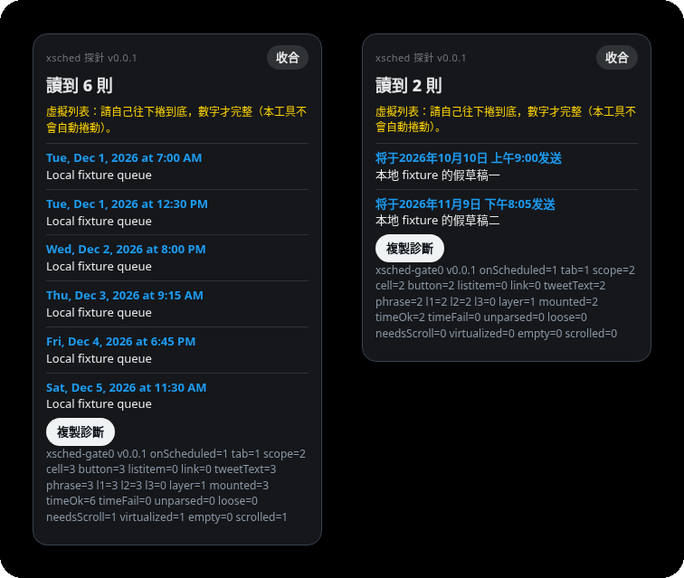

<p align="center">
  
</p>

<p align="center">
  <b>Chrome 擴充：在 x.com 頁面上幫你操作 X 原生排程。</b><br>
  不用 API、不發網路請求、不會自己發文。貼文一律由 X 原生排程送出。
</p>

> [!IMPORTANT]
> **目前版本：0.2.0。** 任一頁打開 Dagaz 都能看已排程總覽（來自上次讀過的 Scheduled 列表）。浮層拖到發文視窗上放開後會停在那裡，重新整理也一樣。快速時段只出現在發新帖的編輯框；回覆、引用、評論框不出現。擴充只填原生欄位，**不會替你按確認、排程或發佈**。

## 快速時段 0.1.5

可以在發文框旁直接選時段，由擴充開原生排程視窗並填好；也可照舊自己開視窗，再在 Dagaz 浮層選 9:00、12:30、20:00 或「下個工作日 9:00」。時段以本地時區計算，選下一次至少比現在晚 5 分鐘的時間；只有你點發文框快速時段才會打開原生視窗；還沒有自訂、星期設定或避開已排推文的功能。

偵測依據是遮罩骨架中的內層 dialog、日期／時間兩個 group、label 關聯及六個原生 select 的選項範圍。骨架的 testid 是空值，不猜前綴。日期與時間欄位必須完整且選項可表示目標值，才會整組填入；年份不在 X 的選項中時會明確報錯，完全不填。

填值使用原生 select value setter 與 input/change，按年→月→日→上下午→時→分依序處理；每欄先重查節點並等待重繪，暫時回收時有限重試；全部填完才核對整組。不符時按原日曆值還原並再次等待。被替換的欄位只有在同一對話框／group 內能以唯一 label 關聯辨識，才會繼續操作；否則會提示還原不完整，請自行檢查。日期 input 只讀 min/max，不直接寫入。**欄位讀回相符仍不代表 X 已排程成功，請自行核對。**

「最後一則＋隨機分鐘」使用最近讀 Scheduled 時看到的最後排程時間，間隔預設 10–30 分，可在設定區儲存正整數 A/B（A ≤ B）。無快取會停用；過期結果改用現在＋隨機間隔，仍保留 5 分鐘安全餘量並向上取整分鐘。時段按鈕標出實際日期、今天／明天；下個工作日顯示日期。浮層高度至少約 2/3 視窗，並納入完整快速操作區；舊的小高度會夾回下限，底部把手可調高、重新整理仍保留。首次填值不縮短，縮小視窗時以視窗邊界為上限，內容仍可捲。

成功填值後，擴充只觀察你親按原生「排程」及相符關閉／新成功提示，確認兩次後，把最後時間推到原快取與本次時間中較晚的那個。浮層九語顯示「剛才排的」或「讀自 Scheduled 列表」；下次讀到有效列表時直接覆蓋。取消、改欄位、錯誤或看不準均不更新；這是畫面觀察，不能代替 X 伺服器確認。

## 排程列表與診斷

<p align="center">
  
</p>

<p align="center"><sub>舊版測試頁示意，不是真實 X 頁面或帳號；目前介面與版本以程式及下方文件為準。</sub></p>

- Scheduled 列表會顯示已讀則數、時間與文字前段。X 採虛擬列表，須自己捲到底；探針不替你捲動。
- Dagaz 快捷鈕與浮層可以分別拖動，位置互相獨立。介面支援九語；時間解析另有繁簡中、英、日、韓及跨年回歸測試。
- 「複製診斷」含版本、命中數、遮罩時間格式與本版的日曆欄位診斷。成功加 fill=ok；失敗逐欄列出目標、讀回及前 3＋最後 1 個安全 option value，不含推文內容、帳號或網址。
- 「複製頁面結構」保留結構並遮罩文字與屬性；0.1.4 保留 select／label 的安全日曆 UI 詞彙 testid，並在 dialog 內 select 行加安全 option value 樣本。只留 1–4 位數字或固定短上下午列舉，其他值與 option 文字仍遮罩。

## 原則：不連線、不代替使用者送出

<p align="center">
  
</p>

- **不用任何 API**：不呼叫 X 官方 API，也不連我們自己或任何第三方伺服器。
- **零網路請求**：不用 `fetch`、XHR、`sendBeacon`、WebSocket、EventSource。verify 靜態守門與 e2e 都要求擴充資源／背景請求為 0；0.1.1 的外部完整 e2e 曾通過 686 斷言；0.1.4 仍須外部重跑，不能沿用舊結果當成本版驗收。
- **零權限**：manifest 沒有 `permissions` 或 host 權限。content script 只在 `x.com` 和 `twitter.com` 執行。
- **只存本機固定 key**：只有位置模組可用 x.com 的 localStorage。兩個位置 key 只存有限數字 `{x,y}`；另有固定 `xsched.probe.quickRange`（A/B）、`xsched.probe.lastScheduled`（最後時間／讀取或記錄時刻／數字來源 1 或 2）、`xsched.probe.panelHeight`（高度）、`xsched.probe.panelOpen`（布林），以及 0.2.0 的 `xsched.probe.overview`（同步時刻＋最多 80 則時間與前 100 字）。診斷不含本文；不加 storage 權限。快取不是即時權威，需自己到 Scheduled 捲到底後核對。
- **不替你送出**：快速時段只填原生欄位，不 click X 的按鈕、不 submit、不派送滑鼠鍵盤事件。最終是否排程由你決定，貼文仍由 X 原生排程發出。

## 載入與實測（≤5 步）

尚未上架 Chrome Web Store。初次使用先下載 repo，在 `chrome://extensions` 開啟開發人員模式，以「載入未封裝項目」選擇 `probe/`；已有 clone 的更新流程如下：

1. 更新 repo 至本版 commit；PR 合併後，可在 main 執行 `git pull --ff-only origin main`。
2. 在 `chrome://extensions` 重新載入 `probe/`，確認 0.2.0；回到 x.com 重新整理頁面。
3. 自己打開 X 原生排程對話框，打開 Dagaz 浮層後立刻點時段，確認完整快速區與所有按鈕可見，高度不塌。
4. 先到 Scheduled 讀列表，再回來用最後一則＋隨機分鐘，逐欄核對；只有確實要排的貼文才親按原生「排程」，看最後時間及來源是否更新。純測試讓計算目標在 2027 年以後；填完再改年份會取消追蹤。
5. 再讀 Scheduled 確認來源回列表，純測試貼文自行刪除；有問題附截圖＋「複製診斷」。真機資料不提交公開 repo。

## 路線

<p align="center">
  
</p>

**1.0 進度：閘 0 已通過；快速時段 0.1.4 待驗證，其餘項目仍在規劃中。**

- **快速時段**：本版提供四個固定未來時段，先手動開 X 對話框，按鈕只填欄位。與原開工卡不同，本版不自動開視窗、不自訂時段／星期，也不計算「避開已排」的空時段；這些留待後續。
- **自動預排**（規劃中，可開關、預設關）：開啟後按「發文」會改走排程，填入下個空時段。
- **避開已排推文**（規劃中）：用列表探針讀到的 X 排程比對空時段，不只看這台電腦記過什麼。
- **排程總覽**（0.2.0）：Dagaz 浮層列出已讀排程的時間、前段文字、總數與最近一則倒數；點列前往 Scheduled。不做編輯／刪除／重排。
- **健康檢查**：找不到原生欄位會明確提示，並保留複製診斷與頁面結構的按鈕。

是否上架商店另行決定。

## 已知限制

- 真骨架提供欄位結構；其他介面與重繪仍可能改版。成功觀察用精確且保守的按鈕／提示文案，尚待真機確認。未知提示、欄位被清空或原 dialog 被替換時不更新；請到 Scheduled 重讀校正。opaque value 仍遮罩，只有安全數字與短列舉樣本可見。
- 自動位置找不到完整空位時仍可能收合；手動位置不因障礙縮高度，可能重疊，請拖到空處。極小視窗無法容納全部快速區時，以視窗邊界與捲動為優先。
- 多個設定對話框、label 關聯歧義、上下午文字與順序矛盾，或無法安全映射的選項，都會拒絕填值。React 回收原節點時，整組還原可能不完整。
- 5 分鐘是本版安全餘量，X 實際允許的最小間隔仍未知。自訂、星期設定與避開已排尚未實作。
- 列表要自己捲到底。同一頁編輯或刪除後，累加資料可能保留舊列；重新進入列表會重讀。時間與全文相同的兩則會去重，純圖片／影片列也可能讀不到。

## 開發

```bash
npm ci
npm test          # 列表、五時段、數字快取、拖曳高度、預檢與整組還原
npm run verify    # 權限、網路、隱私、storage 與不 click／submit 守門
npm run e2e       # Chrome for Testing 載入真 probe/，本機 fixture，零送出斷言
```

`npm run e2e` 需要 Xvfb 與 `CHROME_PATH` 指向 Chrome for Testing。全部只用 fixture，不登入帳號；快速時段 fixture 與測試時鐘皆為 2027 年以後。

0.1.1 的歷史結果：169/169 單元測試、完整 e2e 686 斷言通過。0.1.2 複審前外部完整 e2e 曾通過 911 斷言；複審補修後，npm test 12 檔／細項 199 過，verify 通過（66 洩漏／49 writer 自測，其他守門保留）。沿用 fixture-only CSS，不改網路政策、不豁免 data:；0.1.4 的完整 Chrome e2e 與真頁逐欄驗收仍待外部。本版本機 npm test 13 檔／細項 226 全過，verify OK（37 storage／59 writer，其他守門全保留）；完整 Chrome 結果仍待外部，詳見 0.1.4 HANDOFF。

## 文件

- [`AGENTS.md`](AGENTS.md)：工作規矩與必要測試
- [`docs/plan/ROADMAP.md`](docs/plan/ROADMAP.md)：路線圖與目前進度
- [`notes/GATE0.md`](notes/GATE0.md)：列表讀法、真骨架證據表、原生 writer 與實測步驟
- [`notes/HANDOFF-v1.0-quick-014.md`](notes/HANDOFF-v1.0-quick-014.md)：0.1.4 交接、外部待跑與真機待驗證項目
- 0.1.4 假資料截圖（待外部 e2e 產生）：[`立即填值`](docs/v1.0-quick014-immediate-fill.png)、[`短視窗高度`](docs/v1.0-quick014-height-floor-small.png)、[`觀察關閉`](docs/v1.0-quick014-observed-close.png)、[`列表校正`](docs/v1.0-quick014-list-authoritative.png)
- 舊版範例截圖：[`docs/gate0-en.png`](docs/gate0-en.png)、[`gate0-ja.png`](docs/gate0-ja.png)、[`gate0-zh-Hans.png`](docs/gate0-zh-Hans.png)、[`gate0-zh-Hant.png`](docs/gate0-zh-Hant.png)、[`gate0-ko.png`](docs/gate0-ko.png)、[`gate0-roles-fallback.png`](docs/gate0-roles-fallback.png)、[`gate0-empty.png`](docs/gate0-empty.png)、[`gate0-virtual-before.png`](docs/gate0-virtual-before.png)、[`gate0-virtual-after.png`](docs/gate0-virtual-after.png)
- 標誌：[`docs/xsched-logo-B.svg`](docs/xsched-logo-B.svg)，使用符文 Dagaz，意思是「日子」，整體輪廓像封起來的 X

## 授權

作者：[@punkcan](https://x.com/punkcan)

[MIT](LICENSE)。
