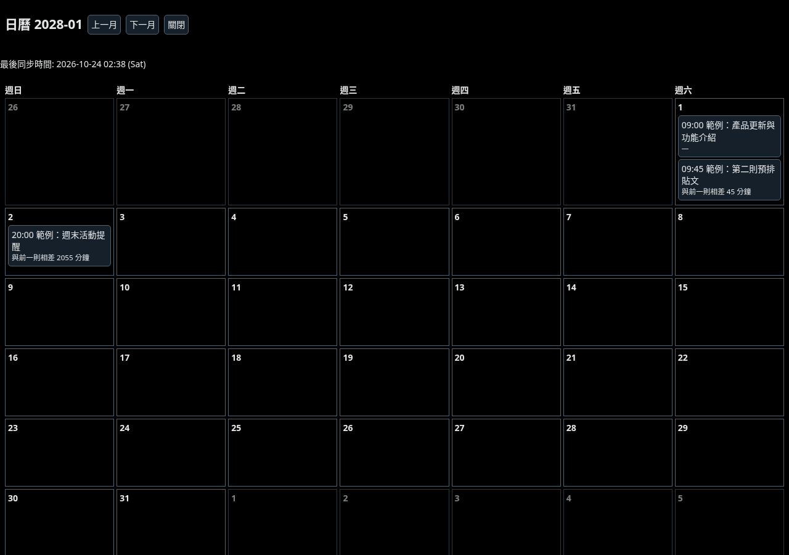
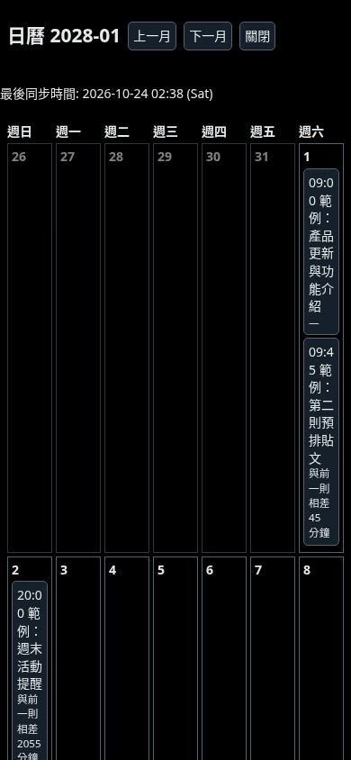

# xsched 0.3.0 迭代審查

審查日期：2026-10-24。基準：`0261372`。範圍：程式行為、排程日曆元件的視覺與鍵盤操作、面板資訊架構。未修改產品程式。

結論：優先處理資料完整性和輸入狀態，再改善日曆響應式與面板層級。現有防誤送出設計、資料長度限制與錯誤分支值得保留。

## 已驗證問題

### P1：同分鐘的不同排程，在分批讀取時會互相覆蓋

- 位置：[overview.js:89](../../../probe/overview.js#L89)，呼叫處 [content.js:947](../../../probe/content.js#L947)。
- 重現：第一個虛擬窗口讀到 09:00 的 Post A；下一個窗口讀到同時間的 Post B。`mergeSnapshots` 最後只留下 Post B。
- 原因：以時間分桶，直接將同時間的舊項目當成內容修改。完整列表同時包含兩則時並非這個問題；問題發生於不完整窗口合併。
- 影響：本機總覽與持久化日曆可能少一則，損害使用者對隊列的信任。
- 建議：不完整窗口不得僅憑時間替換不同摘要；保留不同摘要並標示待完整同步。完整快照才做刪除／替換。前 20 字相同的不同貼文仍存在不可辨識限制，不應宣稱能完全去重。
- 驗收：相同分鐘 A→B→A 分批讀取，不丟失 A/B；完整快照刪除或改文能收斂。

### P1：倒數更新會清掉尚未儲存的輸入

- 位置：[content.js:629](../../../probe/content.js#L629)、[content.js:641](../../../probe/content.js#L641)。
- 本次沿用原 content 測試 harness，間隔 A 原值 10，輸入 123，不按儲存；推進時鐘 61 秒並 poll，欄位重建且值回到 10。
- 原因：剩餘時間列入 render signature，一變動便刪除整個面板子節點；新 input 又從已儲存設定初始化。
- 建議：倒數、狀態、清單分區更新；輸入保留獨立草稿值，保護焦點、選取範圍與捲動位置。
- 驗收：輸入跨分鐘、列表同步、背景 DOM 變動時均不丟草稿；本次實測確認值與節點重建，完整擴充內的焦點／捲動仍待瀏覽器回歸。

### P1（窄視窗）：日曆固定七欄，時間與文字碎裂

- 位置：[calendar.js:141](../../../probe/calendar.js#L141)。
- 本次以正式 calendar.js、overview.js、reader.js 在獨立瀏覽器元件頁呈現。1280px 可以閱讀；390px 下日期格寬 50px，貼文按鈕寬 40px，高約 185–231px，連 09:00 都斷行。
- 建議：窄視窗預設日期分組清單，桌面保留月曆；需要月曆時只在格內顯示時間／則數，選日期後展開明細。至少對 390px、600px 和桌面縮放後的可用寬度驗收。
- 若產品明確只支援寬桌面，此項可降為 P2，但仍應處理窄視窗與放大文字。

### P2：切月後鍵盤焦點遺失

- 位置：[calendar.js:133](../../../probe/calendar.js#L133)。
- 實測：展開後焦點在 calendar-full；點下一月後，焦點落到 BODY，shadowRoot.activeElement 為空；再按 Tab 回到上一月按鈕。
- 原因：drawFull 直接 replaceChildren，移除觸發操作的按鈕。
- 建議：保留工具列節點，只更新標題與格子；或重繪後恢復對應按鈕焦點。用 aria-live 宣告月份變更；檢查 grid 的 row／gridcell 語意和鍵盤策略。
- 已確認優點：Esc 可以關閉，元件獨立測試中焦點會回到「展開」。未執行讀屏器，不作完整 WCAG 合規結論。

## 視覺與 UX 建議

### P2：把面板從診斷工具整理成日常工作介面

程式結構顯示面板同時包含：讀到幾則、快取總覽、快速時段、隨機設定、日曆清單、現場列表、診斷碼與複製按鈕。總覽和現場列表會重複呈現資料。[content.js:674](../../../probe/content.js#L674)、[content.js:791](../../../probe/content.js#L791)、[content.js:867](../../../probe/content.js#L867)。

建議預設只呈現「下一則時間／剩餘多久」「隊列則數＋同步狀態」「查看日曆」。發文時顯示快速時段；隨機設定放進設定區；診斷碼與複製頁面結構放進可展開的疑難排解。這是由程式結構推導的資訊架構建議，尚未在完整擴充畫面驗證擁擠程度。

### P2：清楚區分操作成功、待確認和異常

[content.js:685](../../../probe/content.js#L685) 使用黃色顯示快速時段狀態，未偵測欄位、待確認與完成狀態缺少一致的視覺區分。首頁尚未開啟 picker 時，沒有欄位是正常狀態，不宜持續像錯誤警告。

建議文案流程：「選擇時段」→「已填入，請到 X 確認」→「已觀察到排程完成」。黃色留給待處理問題，狀態用文字和圖示共同區分。不要只靠顏色。預設面板的「探針」「欄位未驗證」等工程文字應移至疑難排解，並保留必要的操作限制說明。

### P2：改善日曆閱讀層級與導覽

桌面截圖可見，所有日期格邊框同等強度，時間與摘要同一文字層級；每張卡都顯示完整間隔句子，例如「與前一則相差 2055 分鐘」。建議減淡空格邊框、突出時間、摘要最多兩行，間隔換成「1天10小時15分」等可掃讀格式。增加「今天」、月份快速跳轉，清楚標明時區；首次開啟優先當月或最近未來排程，避免持久化舊資料將使用者帶回過去月份。

繁中畫面同步時間仍使用 `(Sat)`；面板也有寫死中文的標題／診斷按鈕。統一日期、星期、12/24 小時制與語系字典。這些是呈現優化，不應改變實際排程時區計算。

### P2：固定時段目前沒有隊列衝突提示

[quick.js:42](../../../probe/quick.js#L42) 的 nextSlot 只考慮當前時間與工作日，不讀已排隊列。這是功能缺口，並非本次發現的回歸。建議先加「此時段已有排程」提示；只在已確認完整的列表上提供可靠的避讓，不完整快取要明示限制。不要讓使用者把快捷時間理解成已保證空閒的時段。

## 本次走查步驟與健康狀態

1. 分批讀取隊列：需修正，同分鐘不同內容會被替換（純函式重現）。
2. 編輯隨機間隔並跨分鐘：需修正，未儲存輸入被重設（真 content 的 DOM harness）。
3. 展開桌面日曆：基本可用，資訊層級與導覽有改善空間（瀏覽器元件截圖）。
4. 切換月份：滑鼠可操作，但鍵盤焦點遺失（瀏覽器元件實測）。
5. 窄視窗日曆：閱讀明顯受損（390px 元件截圖）。
6. Esc 關閉：通過，元件測試焦點回到入口。
7. 快捷填值→X 確認→排程完成→原生編輯：本次完整擴充流程受阻，不能宣稱已完成真機驗收。

## 畫面證據

以下為本次由正式日曆元件渲染的合成資料，並非真實 X 帳號畫面，也不是完整擴充整合截圖。截圖已逐張檢查；同步時間依測試瀏覽器 UTC 顯示。





## 驗證與下一輪範圍

- npm test：17 個測試檔通過，0 失敗；這個數字是檔案數，不是全部內部 assertion 數。
- npm run verify：通過，包含既有 1,410 項及 31 項日曆邊界自測。
- 新問題重現腳本：[reproduce.mjs](reproduce.mjs)，結果：[reproduce.log](reproduce.log)。
- 元件走查腳本：[capture.mjs](capture.mjs)，焦點與尺寸觀察：[observations.json](observations.json)。
- 完整擴充 E2E 未執行成功：Chromium 回報 `Loading of unpacked extensions is disabled by the administrator`。本次只另做獨立日曆元件頁測試；未更動瀏覽器政策、未登入 X。沒有以歷史截圖代替本次驗證。

建議下一輪先修資料合併、輸入保存與焦點；接著做窄視窗清單和面板資訊分層；最後再做字級、間距、文案和日期格式統一。每項都能獨立驗收，無須新增權限或 API。多帳號隔離、真 X DOM 最新變動與長清單效能尚未驗證。

重現指令（repo 根目錄，先 npm ci）：

```sh
node docs/reviews/2026-10-24/reproduce.mjs
CHROME_PATH=/path/to/chromium node docs/reviews/2026-10-24/capture.mjs
```

截圖腳本把新產物寫到獨立暫存目錄，不覆寫本次審查證據。reproduce.mjs 會斷言此版本的已知問題，修正後應以新的產品回歸測試取代。
